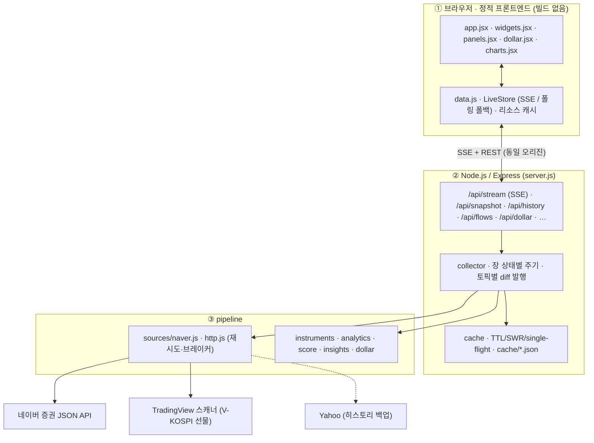

# 📊 시그널보드 (Signalboard)

> 실시간 국내·글로벌 증시 지표 대시보드 — 코스피·코스닥, 글로벌 지수, 금리·환율, 원자재, 수급, MacroScore, 달러 매수 타이밍을 한 화면에서.

🔗 **라이브 데모:** https://signalboard-smx1.onrender.com
> ⏱ 무료 호스팅이라 15분 미사용 후 첫 접속은 깨어나는 데 30~50초 걸립니다.

Node.js(Express) 서버의 **수집기**가 네이버 증권 **배치 JSON API**를 장 상태에 맞춘 주기로 호출해 메모리 스냅샷을 유지하고, 브라우저는 **SSE(Server-Sent Events)** 로 바뀐 데이터만 실시간으로 받습니다. 정적 프론트엔드(빌드 없음)는 위젯 그리드로 시각화합니다.

---

## ✨ 주요 기능

| 탭 | 내용 |
|----|------|
| **홈** | MacroScore · 코스피/코스닥/원달러 · 시장 요약 · 위험 신호 · 공포탐욕 · 트리맵 · 업종 · 수급 보드 |
| **시장** | 코스피·코스닥·**코스피200 선물(실제 선물)** · 지수 보드(52주 위치·이평·실현변동성·수급) · 전 종목 시장 폭·52주 신고/신저가 · 업종 79개 · 거래대금 상위 · 테마 · 프로그램 매매 · 시총 트리맵 · VKOSPI |
| **글로벌** | 10개 지수 정규화 비교 · S&P500·나스닥·SOX·나스닥100·다우·니케이·항셍·상해·DAX·SENSEX·VIX |
| **금리·환율** | 원/달러·달러인덱스·달러/엔·원/엔·원/유로·원/위안 · 한미 기준금리·금리차 · 국고채 1~30년 · 미국채 2~30년 · 장단기 금리차 · 국채 수익률 곡선 |
| **달러** | DollarScope 이식 — **원/달러 매수 타이밍 종합 판단**(11개 지표 점수) · 3년 평균 밴드 차트 · 지표 체크리스트 · 참고 가격대 · 은행 고시 환율 |
| **원자재** | WTI·브렌트·천연가스·금·은·구리·BDI |
| **수급·심리** | 투자자 수급 보드("외인 N주 연속 순매도") · 외국인/기관/개인/연기금 · 신용잔고·예탁금 · 공포탐욕 · VKOSPI · VIX |
| **매크로** | MacroScore(7팩터) · 위험 신호 8종 · 시장 요약 · KOSPI 상관·베타 · 수익률 곡선 |
| **관심종목** | 종목 검색 → 실시간 시세 (서버가 모든 접속자의 관심종목을 1회 호출로 묶어 조회) |

공통: 기간 **1일(1분봉)**·1주·1달·1년·5년 · 라인 차트 마지막 점 실시간 반영 · 값 변경 깜빡임 · 종목 클릭 시 캔들 차트 · 가격 알림(토스트 + 브라우저 알림) · CSV 내보내기 · 위젯 드래그 재배치 · 라이트/다크 · 한국식/미국식 등락 색 · 모바일 대응

---

## ⚡ 실시간 데이터 방식

**왜 바꿨나** — 예전 방식은 Yahoo Finance(현재 429 차단)와 네이버 HTML 스크래핑(금리 페이지 410 종료)을 위젯마다 따로 호출해, 상당수 지표가 들어오지 않거나 느렸습니다.

| 데이터 | 호출 | 예전 |
|--------|------|------|
| 국내 지수 4종 (코스피·코스닥·코스피200·선물) | polling **1회** | Yahoo 3회 |
| 해외 지수 11종 | polling **1회** | Yahoo 10회 |
| 환율·금리·원자재·기준금리 ~50종 | marketIndex/majors **1회** | Yahoo·HTML 수십 회 |
| 수급(장중 잠정)·프로그램·전 종목 등락수·52주 고저 | integration **1회/시장** | HTML 스크래핑 |
| 일별 투자자 수급 2.4년 | trend/daily **3회** (200일/회) | HTML 53페이지 |
| 지수 일봉 5년 | chart **1회** | Yahoo |

- **수집기**: 장중 20초 · 장외(미국장·환율) 60초 · 휴장 5분으로 자동 조절, 접속자가 없으면 수집 중단
- **캐시**: TTL · single-flight(동시 요청 1번만) · stale-while-revalidate · 실패 시 마지막 정상값 · `cache/*.json` 디스크 영속화(재시작해도 다시 받지 않음)
- **HTTP**: keep-alive · 지수 백오프 재시도 · 호스트별 서킷 브레이커
- **전송**: `/api/stream` SSE — 접속 시 전체 스냅샷, 이후 **바뀐 토픽만**(시세는 바뀐 종목만, 분봉은 새 분만) 푸시. SSE 가 막힌 환경은 `/api/snapshot` 폴링(ETag 304)으로 자동 전환, 탭이 숨겨지면 연결 해제

---

## 🏗 아키텍처



> 편집 가능한 원본: **[architecture.drawio](architecture.drawio)**

---

## 🧱 기술 스택

| 영역 | 사용 |
|------|------|
| 백엔드 | Node.js 18+ (내장 fetch), Express 5, compression — 의존성 2개 |
| 프론트 | 정적 HTML/JSX (React 18 + Babel standalone, 빌드 없음), ApexCharts 5, Pretendard |
| 데이터 | 네이버 증권 JSON API, TradingView 스캐너, KRX OpenAPI(선택), Yahoo(백업) |
| 테스트 | node:test (실제 응답 픽스처 기반) |
| 배포 | Render (Web Service, 무료 플랜) |

---

## 🚀 로컬에서 실행

> **사전 준비:** [Node.js](https://nodejs.org) 18 이상

| 방법 | |
|------|---|
| **macOS** | `start.command` 더블클릭 (Node 확인 → 최초 1회 설치 → 서버 → 브라우저 자동 오픈) |
| **Windows** | `start.bat` 더블클릭 또는 `start.ps1` |
| **명령줄** | `npm install` 후 `npm start` → http://localhost:3000 (3000 을 다른 앱이 쓰면 3001, 3002… 로 자동 전환하고 그 주소를 엽니다) |

```bash
npm start          # 서버 시작 (브라우저 자동 오픈)
npm run dev        # 코드 수정 시 자동 재시작 (브라우저 자동 오픈 없음)
npm run check      # 모든 데이터 소스 점검 (서버 없이)
npm test           # 테스트
PORT=3100 npm start   # 포트 고정 (사용 중이면 자동 전환 없이 에러로 종료)
```

---

## ☁️ 웹에 배포하기 (Render — 무료)

1. GitHub에 푸시
2. [render.com](https://render.com) → **New +** → **Blueprint** → 이 레포 선택 → 동봉된 [render.yaml](render.yaml) 로 자동 생성 (헬스체크 `/api/health`)
   - 수동: Web Service · Runtime `Node` · Build `npm install` · Start `node server.js`
3. `main` 브랜치에 push 할 때마다 자동 재배포

> ⚠️ 무료 플랜은 15분간 요청이 없으면 잠듭니다. 브라우저 탭을 열어 두면 SSE 연결이 유지돼 깨어 있고, 아무도 안 보면 서버도 수집을 멈춥니다. 디스크는 휘발성이라 `cache/` 는 재배포 시 초기화되며 자동으로 다시 받습니다.

---

## ⚙️ 환경 변수

모두 선택이며 기본값이 있습니다. 로컬은 `.env`([.env.example](.env.example) 참고), Render 는 Environment 에 등록합니다.

| 변수 | 기본값 | 설명 |
|------|--------|------|
| `PORT` | `3000` | 서버 포트 |
| `NO_OPEN` | — | `1` 이면 브라우저 자동 오픈 안 함 |
| `REFRESH_KR_OPEN` / `REFRESH_ACTIVE` / `REFRESH_CLOSED` | `20` / `60` / `300` | 장중 / 장외 활성 / 휴장 수집 주기(초) |
| `REFRESH_HISTORY` | `3600` | 일별 히스토리·수급·신용 갱신 주기(초) |
| `IDLE_AFTER` | `300` | 마지막 접속 후 이 시간(초)이 지나면 수집 중단 |
| `CACHE_DIR` | `./cache` | 디스크 캐시 위치 |
| `USDKRW_WARNING` · `VIX_WARNING` · `VIX_DANGER` | `1400` · `25` · `35` | 위험 신호 임계값 |
| `KRX_API_KEY` | — | 설정 시 VKOSPI 지수(일별)를 KRX OpenAPI 로 표시 |

---

## 🔌 API 엔드포인트

| 경로 | 설명 |
|------|------|
| `GET /api/stream?watch=005930,…` | **SSE** — `snapshot` 후 `quotes`·`stocks`(바뀐 종목만)·`intraday`(새 분봉만)·`boards`·`treemap`·`movers`·`sectors`·`themes`·`insights`·`dollar`·`series`·`meta` |
| `GET /api/snapshot?watch=…` | 폴링용 전체 스냅샷 (ETag → 304) |
| `GET /api/history/:id?range=1w\|1m\|3m\|6m\|1y\|3y\|5y` | 지표·금리차·`flow-*`·`credit`·`vkospi`·6자리 종목코드(캔들) |
| `GET /api/intraday/:id` | 국내 지수 1분봉 |
| `GET /api/flows?market=KOSPI&days=30` · `/api/flows/weekly?weeks=104` | 투자자 누적·주간 수급 |
| `GET /api/credit` · `/api/global?range=1y` · `/api/treemap?market=kospi&period=weekly` | 신용잔고 · 글로벌 비교 · 트리맵 |
| `GET /api/dollar` · `/api/dollar/status` · `/api/dollar/history` | 달러 매수 타이밍 분석 · **DollarScope 호환** 형식 |
| `GET /api/stocks/quotes?codes=` · `/api/stocks/search?q=` | 종목 시세 · 검색 |
| `GET /api/health` | 소스별 상태·서킷 브레이커·캐시 적중률·구독자 수 |
| `GET /api/series/:id` · `/api/quotes` · `/api/investors` · `/api/investors/weekly` · `/api/breadth` | 예전 API 호환 (스냅샷에서 즉시 응답) |

전체 규격과 업스트림 파싱 정보는 **[api_spec.md](api_spec.md)**, 지표 정의는 **[지표정리.md](지표정리.md)** 참조.

---

## 📁 프로젝트 구조

```
macro/
├─ server.js                Express — REST · SSE · ETag · 예전 API 호환
├─ pipeline/
│  ├─ config.js             환경 변수 설정
│  ├─ http.js               HTTP 클라이언트 (keep-alive · 재시도 · 서킷 브레이커)
│  ├─ cache.js              TTL · single-flight · SWR · 마지막 정상값 · 디스크 영속화
│  ├─ market-hours.js       KST 장 운영 시간 · 휴장일 · 갱신 주기
│  ├─ instruments.js        지표 카탈로그 (지표 ↔ 네이버 코드)
│  ├─ collector.js          수집 루프 · 스냅샷 조립 · 토픽별 diff 발행
│  ├─ analytics.js          이동평균 · 실현변동성 · 백분위 · 상관/베타
│  ├─ score.js              MacroScore
│  ├─ insights.js           위험 신호 · 시장 요약 · 공포탐욕
│  ├─ dollar.js             원/달러 매수 타이밍 (DollarScope)
│  ├─ check.js              데이터 소스 점검 CLI
│  └─ sources/              naver.js (기본) · others.js (TradingView · KRX · Yahoo)
├─ public/                  index.html · data.js · charts.jsx · panels.jsx · dollar.jsx · widgets.jsx · app.jsx
├─ test/                    node:test + fixtures (실제 응답 축약본)
├─ start.command / start.bat / start.ps1   원클릭 실행
└─ render.yaml · architecture.drawio · api_spec.md · 지표정리.md · 실행방법.md
```

---

## 📝 참고

- 네이버 증권 API 는 비공식이라 구조가 바뀔 수 있습니다. `npm run check` 로 소스별 상태를 바로 확인할 수 있고, 장애 시에는 마지막 정상값을 **지연** 배지와 함께 보여줍니다 (가짜 값을 만들지 않음).
- 기준금리는 무료 일별 히스토리가 없어 현재값·최근 결정일만, 회사채 3년은 무료 소스가 없어져 제외했습니다.
- 해외 지수는 거래소 규정상 일부 15분 지연, V-KOSPI 선물은 20분 지연입니다.
- MacroScore·공포탐욕·달러 타이밍은 공개 데이터로 계산한 참고 지표이며, 투자 판단의 책임은 본인에게 있습니다.
